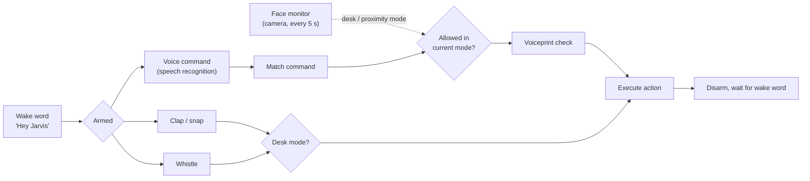

# J.A.R.V.I.S. Automation

J.A.R.V.I.S. Automation is a Windows-based voice and audio control assistant that combines wake-word detection, voice authentication, face presence checks, clap/snap detection, and whistle detection to trigger local desktop actions.

The system is designed to stay in the background, wait for "Hey Jarvis", verify the user, and then execute commands such as opening the browser, opening Amathuba, locking the laptop, changing volume, taking screenshots, or toggling media playback.

## How it works



A clap or whistle cancels a voice command that is still being listened for. Proximity mode (no face at the desk) only allows lock, sleep, volume, shutdown and the mode switches.

## Features

- Wake-word detection with `Hey Jarvis`
- Voice authentication using a saved voiceprint
- Background face monitoring to switch between desk and proximity modes
- Clap/snap detection for quick hands-free actions
- Whistle detection for media and window controls
- Text-to-speech responses for status and feedback
- Optional local roster-cleaning utility

## Requirements

- Windows
- Python 3.10 or newer
- Microphone access
- Webcam access for face monitoring
- A working audio output device

## Installation

1. Clone the repository.
2. Create and activate a virtual environment.
3. Install dependencies:

```bash
pip install -r requirements.txt
```

4. For hand gestures, download the MediaPipe hand model (about 8 MB) to `assets/hand_landmarker.task`:

```bash
curl -L -o assets/hand_landmarker.task https://storage.googleapis.com/mediapipe-models/hand_landmarker/hand_landmarker/float16/latest/hand_landmarker.task
```

Without it, Jarvis still runs and just prints that gestures are off. `requirements.txt` uses `opencv-contrib-python` rather than `opencv-python` because MediaPipe needs it; if you installed the old requirements, run `pip uninstall opencv-python` first so the two don't clash.

## Setup

### 1. Configure the app

The main runtime settings live in [config.json](config.json).

Useful values include:

- `cooldown_seconds`: delay between accepted actions
- `jarvis_responses`: spoken phrases returned by the assistant
- `face_check_enabled`: whether face monitoring is enabled

### 2. Record your voiceprint

The assistant uses [assets/voiceprint.npy](assets/voiceprint.npy) for speaker verification. This file is treated as local-only data.

To generate a new voiceprint, run:

```bash
python train_voice.py
```

Then verify it with the voice tests or by running the main app.

### 3. Review app paths

Browser actions open your default browser, and the URLs live in `APPS` in [modules/actions.py](modules/actions.py).

Screenshots are saved to your Desktop (the OneDrive-synced Desktop if you have one).

## Running the Assistant

Start the full assistant with:

```bash
python main.py
```

What happens at startup:

1. The face monitor starts in the background.
2. The wake-word detector listens for "Hey Jarvis".
3. Clap and whistle detectors start in parallel.
4. After the wake word is heard, the assistant listens for a voice command and verifies the speaker.

Press `Ctrl+C` to shut the system down cleanly.

## Supported Commands

### Voice commands

Say "Hey Jarvis" first, then one of the supported phrases:

- `lock` or `jarvis lock`
- `sleep` or `jarvis sleep`
- `open amathuba` or `jarvis open amathuba`
- `open browser` or `jarvis open browser`
- `open claude` or `jarvis open claude` (empty Claude Code window)
- `open calendar` or `jarvis open calendar` (Google Calendar)
- `volume up` or `jarvis volume up`
- `volume down` or `jarvis volume down`
- `screenshot` or `jarvis screenshot`
- `shutdown` or `jarvis shutdown`
- `silent mode` or `jarvis silent mode`
- `vocal mode` or `jarvis vocal mode`
- `stop`, `jarvis stop`, or `deactivate`

### Clap and snap triggers

- 1 clap/snap: open Amathuba
- 2 claps/snaps: start a spoken Claude task (see below)
- 3 claps/snaps: take a screenshot

Clap and whistle actions can be remapped in the `triggers` block of `config.json`.

### Spoken tasks (double clap)

Say "Hey Jarvis", double clap, wait for "What's the task?", then speak for up to 20 seconds. Your voiceprint is checked, then the task is routed by its first word:

| Say | What happens |
|---|---|
| `note ...` / `take a note ...` | Added with a timestamp to `notes_file` (default `~/Documents/jarvis-notes.md`) |
| `idea ...` / `new idea ...` | Saved to the [Autobuilder](https://github.com/jaswin-codes/autobuilder) inbox, which plans it and builds it a stage at a time |
| anything else | Opens Claude Code in a new window in `default_dir` with the task typed in, e.g. "remind me to email Dr Patil on Monday" uses Claude's Google Calendar connector |

Claude runs interactively, so it asks before risky actions. Paths are set in the `claude` block of `config.json`.

### Whistle triggers

- Short whistle: play/pause media
- Long whistle: maximise the active window

### Hand gestures

Like claps, gestures only work in desk mode after "Hey Jarvis". Hold the pose for about half a second; it fires once, and you drop your hand before it can fire again.

| Pose | Fingers up | Action |
|---|---|---|
| Point | index | Open Claude Code |
| Peace | index + middle | Open Google Calendar |
| Three | index + middle + ring | Open Amathuba |
| Rock | index + pinky | Play/pause media |
| Open palm | all five | Start a spoken Claude task (same as double clap) |

Remap them in the `triggers` block of `config.json`. The webcam is opened once by a shared camera thread that the face monitor and gesture detector both read from, so the camera light stays on while Jarvis runs.

## Modes

The face monitor decides whether the system is in desk mode or proximity mode.

- Desk mode: full command set is available
- Proximity mode: only a limited set of safer voice commands is allowed

## Tests

The repository includes interactive test scripts for the major subsystems:

- `python test_voice.py`
- `python test_face.py`
- `python test_wake_word.py`
- `python test_clap.py`
- `python test_whistle.py`
- `python test_actions.py`
- `python test_tasks.py` and `python test_gestures.py` (no hardware needed)

These scripts are useful for confirming your audio devices, camera, and action mappings before relying on the full assistant.

## Utility Script

`process_roster.py` is a small local utility for cleaning a raw roster export into a simplified surname/first-name format.

Example:

```bash
python process_roster.py input_roster.txt -o cleaned_student_roster.txt
```

If no input file is provided, it looks for `student_roster_raw.txt` in the current folder.

## Project Structure

```text
main.py                 # Main assistant runtime
config.json             # Runtime configuration and spoken responses
process_roster.py       # Optional roster-cleaning utility
train_voice.py          # Voiceprint training script
test_*.py               # Interactive subsystem tests
assets/
  voiceprint.npy        # Saved voiceprint used for authentication
modules/
  actions.py            # Desktop actions triggered by commands
  camera.py             # Shared webcam thread (face + gestures)
  clap_detector.py      # Clap/snap background detector
  face_check.py         # Background face presence monitor
  gesture_detector.py   # MediaPipe hand-pose triggers
  tasks.py              # Routes spoken tasks to notes, Autobuilder or Claude
  voice_auth.py         # Voice verification logic
  voice.py              # Text-to-speech responses
  wake_word.py          # Hey Jarvis wake-word detector
  whistle_detector.py   # Whistle background detector
```

## Privacy

Biometric data stays on your machine: the voiceprint (`assets/voiceprint.npy`), voice training audio and roster files are gitignored, voice verification (Resemblyzer) and wake-word detection (openWakeWord) run locally, and face checks and hand tracking (MediaPipe) process webcam frames locally in memory without saving them.

Two parts use online services: spoken commands are transcribed with Google's speech recognition API (via `speech_recognition`), and Jarvis's replies are synthesised with Microsoft's `edge-tts`.

## Notes

- `assets/voiceprint.npy` and any roster exports should be treated as local-only data.
- Generated audio files and temporary artifacts are cleaned up by the code, but should still be excluded from version control.
- Some actions depend on OS-level behavior such as the Windows lock screen, media keys, and screenshot saving.
